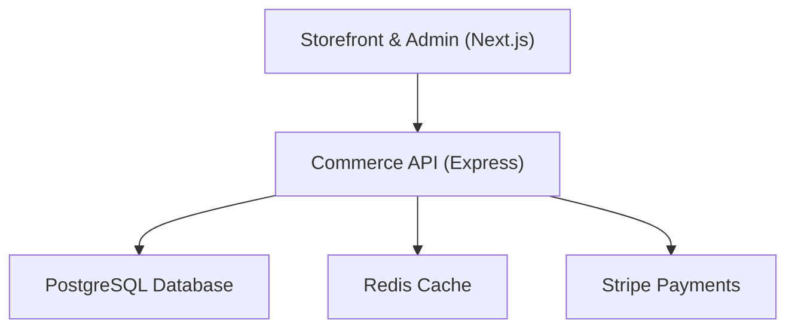
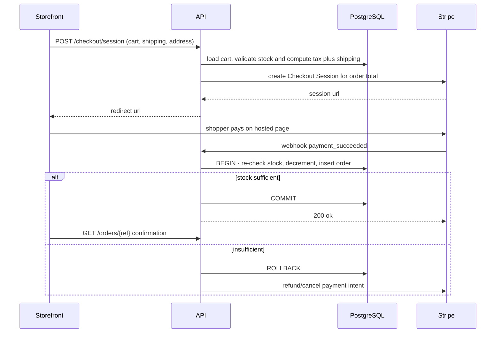
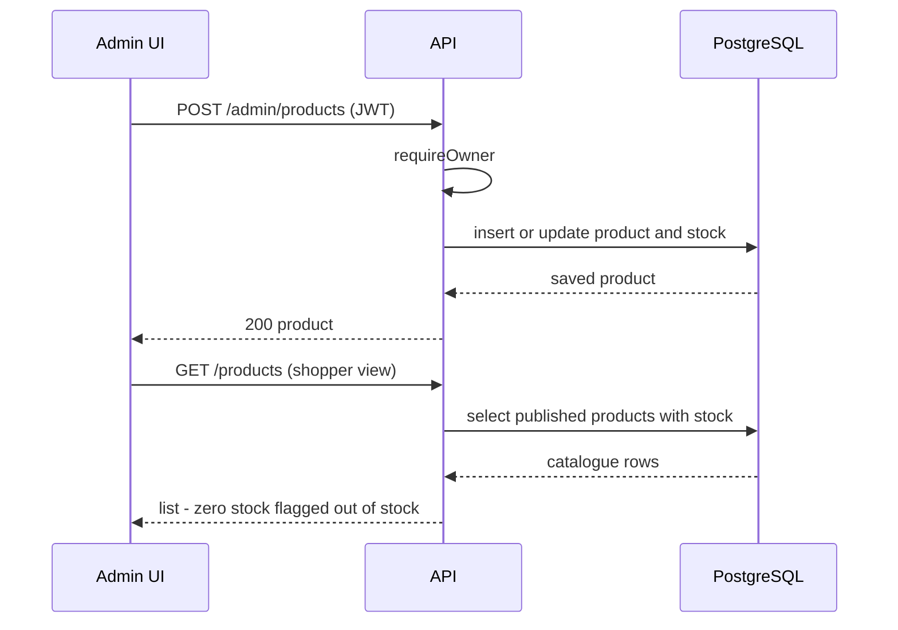
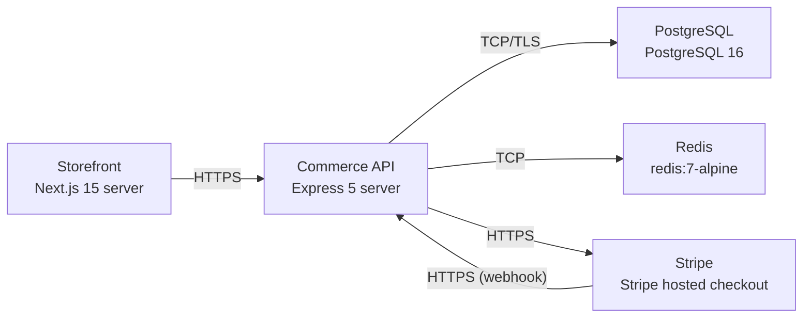

# Architecture

> Maintained by QuorQ AI SDLC. Text between `sdlc:auto` markers is regenerated; anything outside them is yours and is kept.

<!-- sdlc:auto:start narrative -->
## Overview

### ARCH-001 · approved · source: architecture:summary

Overall architecture is approved (version 1): a single-region AWS deployment with Next.js 15 storefront/admin, Express 5 API, PostgreSQL 16, Redis cache, and Stripe-hosted checkout for a small single-country shop.

System is a lightweight single-region e-commerce storefront. Next.js 15 server-renders catalogue/product pages (SEO, fast mobile load) and owner admin screens. Express 5 exposes REST APIs, creates Stripe Checkout sessions, handles webhooks, enforces authorization, and runs the atomic stock-decrement transaction. PostgreSQL 16 is the single source of truth for catalogue, carts, orders, stock and accounts. Redis caches catalogue reads and holds short-lived guest cart/session data. Stripe hosts card payment so card data never touches the application. Guest checkout is the primary path; stock decrements atomically inside a PostgreSQL transaction at payment confirmation to prevent overselling.

- ⚠ Input does not map architecture components/endpoints explicitly to the US-001..US-020 requirement IDs, so full requirement traceability for this phase cannot be confirmed without additional input.

### ARCH-002 · approved · source: architecture:component:storefront

Storefront & Admin component (Next.js 15) server-renders the shopper-facing site and hosts the owner's admin dashboard in one codebase.

Server-renders catalogue and product detail pages for SEO and fast mobile load; renders responsive cart, guest checkout flow, optional account pages, privacy notice and cookie consent; renders owner admin dashboard; redirects to Stripe-hosted payment for the card-entry step.

### ARCH-003 · approved · source: architecture:component:api

Commerce API component (Express 5) is the backend exposing all REST endpoints and owning checkout/payment/stock logic.

Exposes REST endpoints for catalogue, cart, checkout, orders, accounts, product/stock management, shipping and tax config, and admin fulfilment. Creates Stripe Checkout sessions, handles Stripe webhooks, enforces owner/shopper authorization, and runs the atomic stock-decrement transaction.

### ARCH-004 · approved · source: architecture:component:db

PostgreSQL 16 is the single transactional data store for the whole system.

Single source of truth for products, stock, carts, orders, order items, customers, shipping options and tax settings. Enforces transactional consistency so stock is never oversold (ACID transactions back the atomic stock-decrement at payment confirmation).

### ARCH-005 · approved · source: architecture:component:cache

Redis caches catalogue reads and holds short-lived guest cart/session data to keep pages fast under traffic spikes.

Deployed as redis:7-alpine. Used for: (1) caching catalogue read queries to reduce DB load, (2) holding short-lived guest cart/session references. Not used as a system of record -- PostgreSQL remains authoritative for cart/order state.

### ARCH-006 · approved · source: architecture:component:stripe

Stripe (SaaS) hosts the card payment step so card data never touches the application.

Hosts the card payment step, charges the order total in the single configured currency, and confirms payment via webhook back to the Commerce API, which then creates the order and decrements stock atomically.

### ARCH-007 · approved · source: architecture:critical_path:guest_checkout

Primary critical path: guest checkout through payment to atomic stock decrement.

Shopper proceeds from cart to guest checkout, enters contact email and shipping address, selects a flat-rate shipping option, sees tax and total, pays via Stripe-hosted checkout. On Stripe webhook confirmation, the order is created and stock decremented atomically in a single PostgreSQL transaction. If stock is insufficient at confirmation time, the order is not completed -- this guards against overselling under concurrent last-unit purchases.

**Related:** ARCH-002, ARCH-003, ARCH-004, ARCH-006

- ⚠ No explicit requirement ID links given in input for this critical path; mapping to shopper-facing user stories (e.g. checkout/cart stories) is inferred, not confirmed.

### ARCH-008 · approved · source: architecture:critical_path:owner_product_management

Critical path for owner catalogue and stock management.

Signed-in owner creates or edits a product with name, description, price, image URL and stock, and publishes/unpublishes it. Changes are reflected immediately in the shopper-facing catalogue; a product with zero stock is automatically marked out of stock.

**Related:** ARCH-002, ARCH-003, ARCH-004

- ⚠ No explicit requirement ID links given in input for this critical path.

### ARCH-009 · approved · source: architecture:entities

Data model defines eight entities covering catalogue, carts, orders, customers, shipping and tax settings, all living in PostgreSQL.

products(id, name, description, price_cents, image_url, stock_quantity, published, created_at); customers(id, email, password_hash, created_at); carts(id, customer_id, status, created_at); cart_items(id, cart_id, product_id, quantity); shipping_options(id, name, cost_cents, active); store_settings(id, tax_rate_percent, currency); orders(id, order_reference, customer_id, contact_email, shipping_name, shipping_address, shipping_option_id, subtotal_cents, shipping_cents, tax_cents, total_cents, currency, status, stripe_payment_intent, created_at); order_items(id, order_id, product_id, product_name, unit_price_cents, quantity).

**Related:** ARCH-004

### ARCH-010 · approved · source: architecture:endpoints:shopper

Shopper-facing and account REST endpoints covering catalogue browsing, cart, checkout, orders and account management.

GET /products (list published products, image/name/price/stock flag); GET /products/:id (product detail); POST /carts (create cart, guest or signed-in); POST /carts/:id/items (add item, quantity capped at stock); PATCH /carts/:id/items/:itemId (update quantity, capped, or remove); DELETE /carts/:id/items/:itemId (remove line); GET /carts/:id (get cart with recalculated subtotal); GET /shipping-options (list active flat-rate options); GET /settings/tax (get configured tax rate and currency); POST /checkout/session (validate cart, compute tax+shipping, create Stripe Checkout session); POST /webhooks/stripe (on payment success, create order and decrement stock atomically); GET /orders/:reference (fetch order for confirmation screen); POST /auth/register (create email account); POST /auth/login (sign in, receive JWT); GET /account/orders (list signed-in shopper's past orders); DELETE /account (delete account and personal data, retain order records as legally required).

**Related:** ARCH-003, ARCH-009

### ARCH-011 · approved · source: architecture:endpoints:admin

Owner/admin REST endpoints covering product, shipping, tax and order fulfilment management.

POST /admin/products (owner creates product); PATCH /admin/products/:id (owner edits product, stock or publish state); DELETE /admin/products/:id (owner removes/unpublishes product); POST /admin/shipping-options (owner creates flat-rate shipping option); PATCH /admin/shipping-options/:id (owner edits or deactivates shipping option); PUT /admin/settings/tax (owner sets single tax/VAT rate and currency); GET /admin/orders (owner dashboard: recent orders and those awaiting shipment); GET /admin/orders/:id (owner views full order details); PATCH /admin/orders/:id/ship (owner marks order shipped).

**Related:** ARCH-003, ARCH-008, ARCH-009

### ARCH-012 · approved · source: architecture:deployment_nodes

All components deploy to a single AWS region: storefront and API as containers on ECS Fargate, PostgreSQL on RDS, Redis on ElastiCache (or container in dev), and Stripe as an external SaaS dependency.

Storefront: Next.js 15 server, Node.js 20 container on AWS ECS Fargate. Commerce API: Express 5 server, Node.js 20 container on AWS ECS Fargate. PostgreSQL: PostgreSQL 16 on AWS RDS, single region, encryption at rest via KMS. Redis: redis:7-alpine, run as a container on ECS in dev and AWS ElastiCache in higher environments. Stripe: hosted checkout, SaaS (external), not deployed by the project.

**Related:** ARCH-002, ARCH-003, ARCH-004, ARCH-005, ARCH-006

### ARCH-013 · approved · source: architecture:technology_decision:frontend

Frontend technology decision: Next.js 15 chosen over Remix and plain React SPA.

Server-renders catalogue and product pages so content is present for search engines and loads fast on phones (referenced as NFR-001, NFR-002), and hosts the responsive storefront plus owner admin in one codebase.

**Related:** ARCH-002

- ⚠ NFR-001 and NFR-002 are referenced as the rationale but are not present in the known requirement key list (US-001..US-020) supplied for this phase -- confirm whether these NFRs are tracked elsewhere.

### ARCH-014 · approved · source: architecture:technology_decision:backend

Backend technology decision: Express 5 chosen over NestJS and Fastify.

Minimal, well-understood API layer for the REST endpoints, Stripe session creation and webhook handling, with the atomic stock-decrement transaction living in its order service.

**Related:** ARCH-003

### ARCH-015 · approved · source: architecture:technology_decision:database

Database technology decision: PostgreSQL 16 chosen over MySQL and MongoDB.

ACID transactions guarantee stock is decremented safely under concurrent last-unit purchases (referenced as NFR-006), and a single relational store holds catalogue, carts, orders, accounts, shipping and tax settings.

**Related:** ARCH-004, ARCH-007

- ⚠ NFR-006 is referenced as rationale but is not present in the known requirement key list (US-001..US-020) supplied for this phase -- confirm whether it is tracked elsewhere.

### ARCH-016 · approved · source: architecture:technology_decision:cloud

Cloud technology decision: AWS chosen over Google Cloud and Azure.

Runs storefront, API, managed RDS PostgreSQL and Redis in one region close to the single-country market, scaling from quiet to spike without re-platforming.

**Related:** ARCH-012
<!-- sdlc:auto:end narrative -->

<!-- sdlc:auto:start building-blocks -->
## Building Block View

| ID | Name | Technology | Responsibility | Depends on |
|---|---|---|---|---|
| storefront | Storefront & Admin (Next.js) | Next.js 15 | Server-renders catalogue and product detail pages for SEO and fast mobile load, renders the responsive cart, guest checkout flow, optional account pages, privacy notice and cookie consent, and the owner admin dashboard. Redirects to Stripe-hosted payment. | api |
| api | Commerce API (Express) | Express 5 | Exposes REST endpoints for catalogue, cart, checkout, orders, accounts, product/stock management, shipping and tax config, and admin fulfilment. Creates Stripe Checkout sessions, handles Stripe webhooks, enforces owner/shopper authorization, and runs the atomic stock-decrement transaction. | db, cache, stripe |
| db | PostgreSQL Database | PostgreSQL 16 | Single source of truth for products, stock, carts, orders, order items, customers, shipping options and tax settings. Enforces transactional consistency so stock is never oversold. | — |
| cache | Redis Cache | Redis (redis:7-alpine) | Caches catalogue read queries and holds short-lived guest cart/session references to keep pages fast under traffic spikes. | — |
| stripe | Stripe Payments | Stripe (SaaS) | Hosts the card payment step, charges the order total in the single configured currency, and confirms payment via webhook. The application never stores card numbers. | — |

<!-- sdlc:auto:end building-blocks -->

<!-- sdlc:auto:start runtime -->
## Runtime View

### Guest checkout, payment and atomic stock decrement

Shopper proceeds from cart to guest checkout, enters contact email and shipping address, selects a flat-rate shipping option, sees tax and total, pays via Stripe-hosted checkout, and on webhook confirmation the order is created and stock decremented atomically. If stock is insufficient at confirmation, the order is not completed.

- **Components:** storefront, api, db, stripe
- **Modules:** checkout.controller, order.service, stock.service, stripe.service, webhook.controller
- **Key functions:** createCheckoutSession(cartId, shippingOptionId, contact, address), calculateTotals(cartId, shippingOptionId, taxRate), handleStripeWebhook(event), placeOrderWithStockDecrement(cartId, paymentIntentId)

### Owner product and stock management

Signed-in owner creates or edits a product with name, description, price, image URL and stock, and publishes/unpublishes it. Changes are reflected in the shopper-facing catalogue; zero stock marks the product out of stock.

- **Components:** storefront, api, db
- **Modules:** admin.auth, product.controller, product.service
- **Key functions:** requireOwner(req), upsertProduct(payload), setStock(productId, quantity), setPublished(productId, published)

<!-- sdlc:auto:end runtime -->

<!-- sdlc:auto:start deployment-view -->
## Deployment View

| Name | Service | Runtime | Scaling | Environment |
|---|---|---|---|---|
| Storefront | Next.js 15 server | Node.js 20 container on AWS (ECS Fargate) | horizontal, 1-N tasks behind ALB | dev |
| Commerce API | Express 5 server | Node.js 20 container on AWS (ECS Fargate) | horizontal, 1-N tasks behind ALB | dev |
| PostgreSQL | PostgreSQL 16 | AWS RDS for PostgreSQL 16, single region, encryption at rest (KMS) | vertical, single instance for dev | dev |
| Redis | redis:7-alpine | Container on ECS (dev) / AWS ElastiCache in higher envs | single node | dev |
| Stripe | Stripe hosted checkout | SaaS (external) | managed by provider | dev |

| Source | Target | Protocol |
|---|---|---|
| Storefront | Commerce API | HTTPS |
| Commerce API | PostgreSQL | TCP/TLS |
| Commerce API | Redis | TCP |
| Commerce API | Stripe | HTTPS |
| Stripe | Commerce API | HTTPS (webhook) |

<!-- sdlc:auto:end deployment-view -->

<!-- sdlc:auto:start decisions -->
## Architecture Decisions

| Layer | Choice | ADR |
|---|---|---|
| Frontend | Next.js 15 | [ADR-0001](adr/frontend.md) |
| Backend | Express 5 | [ADR-0002](adr/backend.md) |
| Database | PostgreSQL 16 | [ADR-0003](adr/database.md) |
| Cloud | AWS | [ADR-0004](adr/cloud.md) |
<!-- sdlc:auto:end decisions -->

<!-- sdlc:auto:start links -->
## Related Documents

- [Data Model](data-model.md)
- [API Specification](api/openapi.yaml)
- [Architecture Decision Records](adr/README.md)
<!-- sdlc:auto:end links -->
