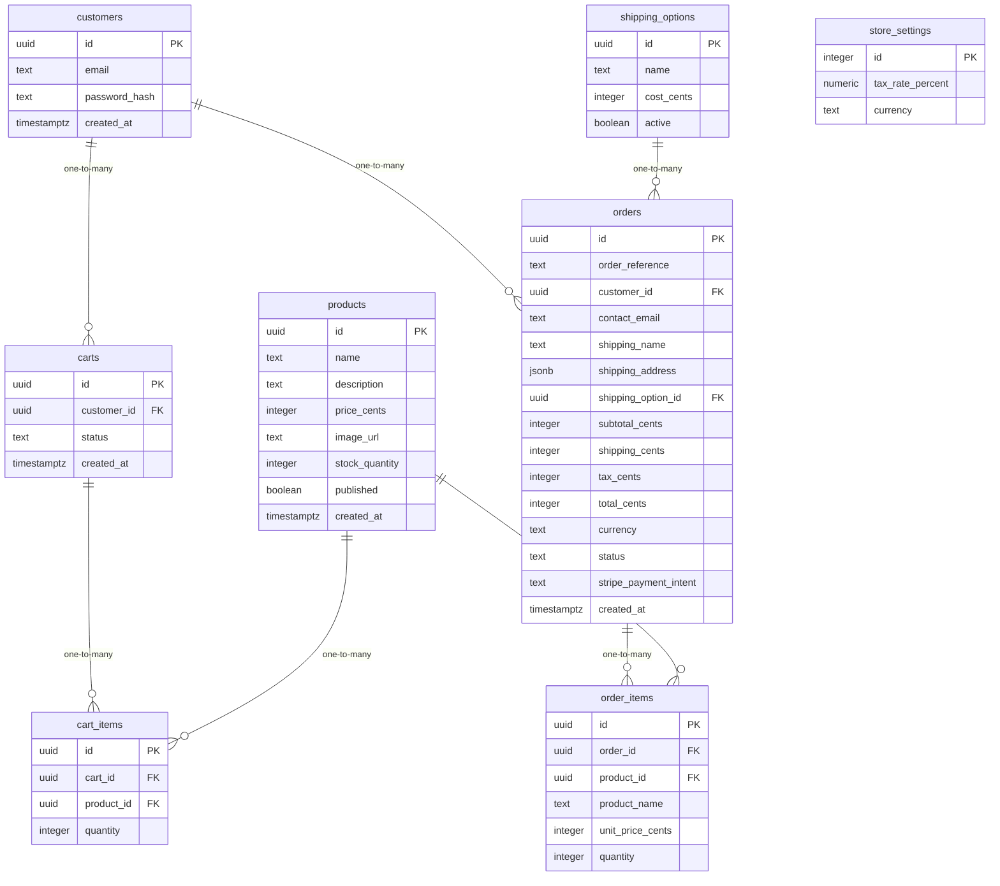

# Data Model

<!-- sdlc:auto:start entities -->
### products

| Field | Type | PK | FK | Nullable |
|---|---|---|---|---|
| id | uuid | True | — | False |
| name | text | False | — | False |
| description | text | False | — | True |
| price_cents | integer | False | — | False |
| image_url | text | False | — | True |
| stock_quantity | integer | False | — | False |
| published | boolean | False | — | False |
| created_at | timestamptz | False | — | False |

### customers

| Field | Type | PK | FK | Nullable |
|---|---|---|---|---|
| id | uuid | True | — | False |
| email | text | False | — | False |
| password_hash | text | False | — | False |
| created_at | timestamptz | False | — | False |

### carts

| Field | Type | PK | FK | Nullable |
|---|---|---|---|---|
| id | uuid | True | — | False |
| customer_id | uuid | False | customers.id | True |
| status | text | False | — | False |
| created_at | timestamptz | False | — | False |

### cart_items

| Field | Type | PK | FK | Nullable |
|---|---|---|---|---|
| id | uuid | True | — | False |
| cart_id | uuid | False | carts.id | False |
| product_id | uuid | False | products.id | False |
| quantity | integer | False | — | False |

### shipping_options

| Field | Type | PK | FK | Nullable |
|---|---|---|---|---|
| id | uuid | True | — | False |
| name | text | False | — | False |
| cost_cents | integer | False | — | False |
| active | boolean | False | — | False |

### store_settings

| Field | Type | PK | FK | Nullable |
|---|---|---|---|---|
| id | integer | True | — | False |
| tax_rate_percent | numeric | False | — | False |
| currency | text | False | — | False |

### orders

| Field | Type | PK | FK | Nullable |
|---|---|---|---|---|
| id | uuid | True | — | False |
| order_reference | text | False | — | False |
| customer_id | uuid | False | customers.id | True |
| contact_email | text | False | — | False |
| shipping_name | text | False | — | False |
| shipping_address | jsonb | False | — | False |
| shipping_option_id | uuid | False | shipping_options.id | True |
| subtotal_cents | integer | False | — | False |
| shipping_cents | integer | False | — | False |
| tax_cents | integer | False | — | False |
| total_cents | integer | False | — | False |
| currency | text | False | — | False |
| status | text | False | — | False |
| stripe_payment_intent | text | False | — | True |
| created_at | timestamptz | False | — | False |

### order_items

| Field | Type | PK | FK | Nullable |
|---|---|---|---|---|
| id | uuid | True | — | False |
| order_id | uuid | False | orders.id | False |
| product_id | uuid | False | products.id | True |
| product_name | text | False | — | False |
| unit_price_cents | integer | False | — | False |
| quantity | integer | False | — | False |
<!-- sdlc:auto:end entities -->

<!-- sdlc:auto:start relationships -->
| Source | Target | Type |
|---|---|---|
| carts | cart_items | one-to-many |
| products | cart_items | one-to-many |
| customers | carts | one-to-many |
| customers | orders | one-to-many |
| orders | order_items | one-to-many |
| products | order_items | one-to-many |
| shipping_options | orders | one-to-many |
<!-- sdlc:auto:end relationships -->

<!-- sdlc:auto:start er-diagram -->

<!-- sdlc:auto:end er-diagram -->
