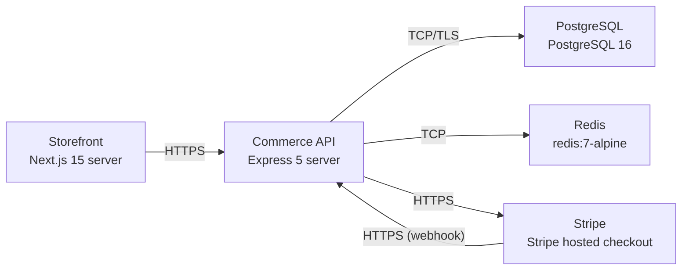

# Deployment Guide

> Maintained by QuorQ AI SDLC. Text between `sdlc:auto` markers is regenerated; anything outside them is yours and is kept.

<!-- sdlc:auto:start how-it-deploys -->
Pushes to `main` run `.github/workflows/deploy.yml`, which builds the API image (if there is a backend) and deploys the SPA to AWS Amplify. Commits touching only `docs/sdlc/**` don't deploy. Deployments can also be started from the platform's Deployment tab.
<!-- sdlc:auto:end how-it-deploys -->

<!-- sdlc:auto:start environments -->
| Name | Service | Runtime | Scaling | Environment |
|---|---|---|---|---|
| Storefront | Next.js 15 server | Node.js 20 container on AWS (ECS Fargate) | horizontal, 1-N tasks behind ALB | dev |
| Commerce API | Express 5 server | Node.js 20 container on AWS (ECS Fargate) | horizontal, 1-N tasks behind ALB | dev |
| PostgreSQL | PostgreSQL 16 | AWS RDS for PostgreSQL 16, single region, encryption at rest (KMS) | vertical, single instance for dev | dev |
| Redis | redis:7-alpine | Container on ECS (dev) / AWS ElastiCache in higher envs | single node | dev |
| Stripe | Stripe hosted checkout | SaaS (external) | managed by provider | dev |
<!-- sdlc:auto:end environments -->

<!-- sdlc:auto:start live -->
_Not deployed yet._
<!-- sdlc:auto:end live -->

<!-- sdlc:auto:start topology -->

<!-- sdlc:auto:end topology -->
